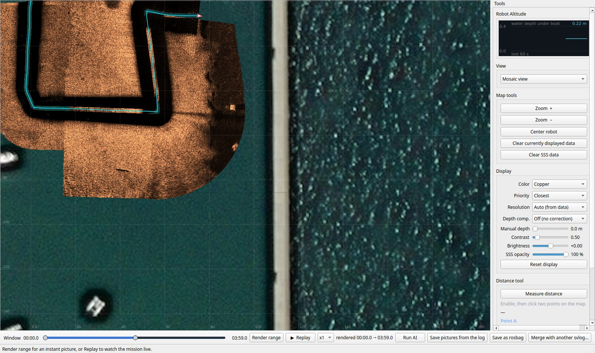
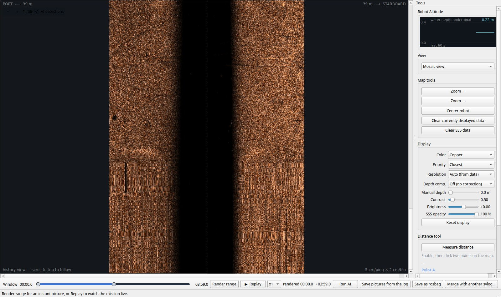

# BlueBoat-SSS

Side-scan sonar (SSS) acquisition, processing and operator display for the BlueBoat uncrewed
surface vessel (USV). This module drives the boat's two Cerulean Omniscan 450 SS sonars (port and
starboard), turns their pings into positioned rows, records SonarView-compatible `.svlog` files,
and shows everything live in the **Ground Control Station (GCS)** desktop app.



*The GCS replay window on a real harbour recording. The copper area is the sonar mosaic: the
seabed seen by both sonars, placed on the satellite map. The blue line is the boat's track; the
black band along it is the water column under the boat, where a side-scan sonar sees nothing.
Bright marks are objects; the dark area behind an object is its acoustic shadow.*

## What you can do with it

- **Drive the two sonars** from the laptop over the BlueBoat WiFi, at the settings SonarView uses
  (20 m per side, 1200 samples, 20 pings per second).
- **Watch the seabed live**: a waterfall (the newest ping on top) and a mosaic over satellite
  imagery, with the boat's track, the acoustic pinger and the detections from BlueBoat-Perception.
- **Record a session**: the `.svlog` sonar log, the mosaic, the waterfall and the seabed images
  in one folder per recording.
- **Make seabed images for the detector**: square-pixel pictures with all the metadata needed to
  place every pixel on the map, sent live to BlueBoat-Perception.
- **Replay any `.svlog`** (yours or SonarView's): render it as a mosaic or waterfall, save its
  pictures, run the detector on it, merge two logs or convert it to a ros2 bag.
- **Change the sonar range while running**, from a slider.
- **Work without the boat**: a built-in demo mode needs no ROS and no sonar.



*The same recording as a waterfall: port on the left, starboard on the right, one row per ping,
the newest at the top. The dark centre is the water column under the boat. The bottom right
corner gives the scale (centimetres per ping and per sample).*

## How it connects to the other modules

```
[ sonar: BlueBoat-SSS ] → Perception → Belief → Replanner → Control
```

| Module | Link | Relation to this module |
|---|---|---|
| BlueBoat-Control | [github.com/Kyyrron/BlueBoat-Control](https://github.com/Kyyrron/BlueBoat-Control) | Provides the message types (`blueboat_interfaces`) and the boat's position (`/blueboat/odom`); build it first |
| BlueBoat-Perception | [github.com/Kyyrron/BlueBoat-Perception](https://github.com/Kyyrron/BlueBoat-Perception) | Receives every seabed image; its detections are the only ones the GCS draws |
| BlueBoat-Belief | [github.com/Kyyrron/BlueBoat-Belief](https://github.com/Kyyrron/BlueBoat-Belief) | Reads the processed pings (`/sss_processor/processed`) |
| BlueBoat-SSS-Sim | [github.com/Kyyrron/BlueBoat-SSS-Sim](https://github.com/Kyyrron/BlueBoat-SSS-Sim) | Replaces the sonar driver in simulation with a node of the same name and topics |
| BlueBoat-MCS | [github.com/Kyyrron/BlueBoat-MCS](https://github.com/Kyyrron/BlueBoat-MCS) | The Mission Control Station (MCS) that runs the mission beside the GCS |
| Whole project | [github.com/Kyyrron/BlueBoat-SideScanSonar](https://github.com/Kyyrron/BlueBoat-SideScanSonar) | The superproject that holds every module |

All the software runs on the operator laptop. The sonar driver reaches the sonars over the BlueBoat
Base Station WiFi (`192.168.2.92` port, `192.168.2.93` starboard). The GCS runs no detector itself.

The module has two parts:

| Part | What it is |
|---|---|
| `blueboat_sss` | ROS 2 package: the sonar driver and the processor. Details: [blueboat_sss/README.md](blueboat_sss/README.md) |
| `blueboat_sss/blueboat_gcs` | The GCS desktop app (PySide6). Not a colcon package: it runs from its folder |

## Dependencies

| Dependency | Link | Quick install |
|---|---|---|
| Ubuntu 24.04, ROS 2 Jazzy | [docs.ros.org](https://docs.ros.org/en/jazzy/Installation/Ubuntu-Install-Debs.html) | `sudo apt install ros-jazzy-desktop` |
| `blueboat_interfaces` | [BlueBoat-Control](https://github.com/Kyyrron/BlueBoat-Control) | built in the same workspace |
| ROS packages for the nodes | apt | `sudo apt install ros-jazzy-simple-launch ros-jazzy-mavros-msgs ros-jazzy-geographic-msgs ros-jazzy-rosbag2-py python3-scipy` |
| GCS Python packages (PySide6, numpy, opencv-python, PyYAML) | `requirements.txt` | `pip install -r requirements.txt` |
| SonarView (optional) | [Cerulean Sonar](https://ceruleansonar.com/pages/sonarview) | to open `.svlog` files in the vendor's viewer |

Keep numpy below version 2 in the Python you run the nodes with: the ROS 2 Jazzy packages and
scipy are built against numpy 1. On a system Python, pip may need `--break-system-packages`.

## Installation, step by step

```bash
# 1. Get the project with its submodules (or clone https://github.com/Kyyrron/BlueBoat-SSS alone)
mkdir -p ~/ros2_ws/src && cd ~/ros2_ws/src
git clone --recurse-submodules https://github.com/Kyyrron/BlueBoat-SideScanSonar.git

# 2. ROS packages the nodes need
sudo apt install ros-jazzy-simple-launch ros-jazzy-mavros-msgs ros-jazzy-geographic-msgs \
                 ros-jazzy-rosbag2-py python3-scipy

# 3. GCS Python packages, in the workspace venv
cd ~/ros2_ws && source .venv/bin/activate
pip install -r src/BlueBoat-SideScanSonar/BlueBoat-SSS/requirements.txt

# 4. Build: the message types first, then the sonar package
cd ~/ros2_ws && source /opt/ros/jazzy/setup.bash
colcon build --packages-select blueboat_interfaces
colcon build --packages-select blueboat_sss

# 5. Every new terminal
cd ~/ros2_ws && source env.sh       # env.sh: "source .venv/bin/activate" + "source install/setup.bash"
```

The GCS needs no build. `build.sh` (in this folder) runs `colcon build`, sources `env.sh` and
starts the GCS in one go.

## Check the installation

```bash
# 1. The GCS in demo mode: no ROS, no sonar
cd ~/ros2_ws/src/BlueBoat-SideScanSonar/BlueBoat-SSS/blueboat_sss
python3 -m blueboat_gcs.main --sim
```

The window opens; press **START** and a simulated mosaic and waterfall build up.

```bash
# 2. The ROS nodes are installed
cd ~/ros2_ws && source env.sh
ros2 launch blueboat_sss SSS_processing_launch.py --show-args
```

## Tips: when to use it, what to know

- **Start the GCS from the `blueboat_sss/` folder.** It imports its package and resolves its data
  folder from there.
- **Normal operation**: start the GCS, choose the **Sonar** source (*Simulation* or *Real
  sonars*), press **START**, then **Record ON / OFF** around what you want to keep, then **STOP**.
  The GCS launches and stops the sonar nodes itself. Full walk-through:
  [docs/USER_GUIDE.md](docs/USER_GUIDE.md).
- **Pinging and recording are off at start-up**, on purpose.
- **Set the range from the water depth** (about four times the deepest water), not from the area
  to cover. Too long a range breaks bottom tracking. The project's setting is 20 m.
- **Do not leave the sonars pinging for long out of water**: the transducer can overheat.
- **Data leaves the GCS only through a recording session.** If nothing was recording, STOP saves
  nothing.
- **Recorded `.svlog` files are field data**: never edit or overwrite them.
- **Simulated pictures are brighter and more even than real ones.** Never quote a simulated level
  as a field level (superproject `SIM_VALIDITY_CONDITIONS.md`).
- **The sonar topics use "best effort" delivery.** A subscriber set to "reliable" receives
  nothing; change the delivery setting at both ends or not at all.

## More documentation

| Document | What you find there |
|---|---|
| [docs/USER_GUIDE.md](docs/USER_GUIDE.md) | Using the GCS: start, record, replay, configuration, data folders, topics |
| [blueboat_sss/README.md](blueboat_sss/README.md) | The two ROS nodes: launches, parameters, recording, health checks, offline tools |
| [docs/DEVELOPMENT.md](docs/DEVELOPMENT.md) | How to work on this module: Claude Code, setup, tests, rules, next steps |
| [blueboat_gcs/docs/ARCHITECTURE.md](blueboat_sss/blueboat_gcs/docs/ARCHITECTURE.md) | How the GCS is built |
| [blueboat_gcs/docs/PERCEPTION_INTEGRATION.md](blueboat_sss/blueboat_gcs/docs/PERCEPTION_INTEGRATION.md) | The seabed images sent to BlueBoat-Perception |
| [blueboat_gcs/docs/SONARVIEW_SVLOG_ANALYSIS.md](blueboat_sss/blueboat_gcs/docs/SONARVIEW_SVLOG_ANALYSIS.md) | The `.svlog` format and the measured device settings |
| [blueboat_gcs/docs/SCIENTIFIC_BACKGROUND.md](blueboat_sss/blueboat_gcs/docs/SCIENTIFIC_BACKGROUND.md) | Side-scan sonar background and the display model |
| [blueboat_gcs/docs/HANDOVER.md](blueboat_sss/blueboat_gcs/docs/HANDOVER.md) | The GCS's integration points with the other modules |

---

**Author** — BERTRAND Killian, Kyushu Institute of Technology, 2026.
